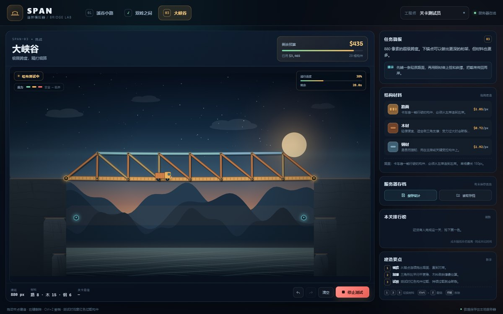

# SPAN · 造桥模拟器

一个纯 HTML + TypeScript + Node 服务器存储的网页版造桥模拟器。在预算内连接两岸、铺设路面，让卡车通过；桥梁会实时受力、变形，过载构件会断裂。



## 蓝图 2.0 更新

- **视觉**：黄昏蓝图场景重绘，增加岩层/雾/水面反光/施工塔吊/测量旗；预算环、结构完整度、最大应力、拉压图例；卡车悬挂、扬尘、车灯、断裂碎屑与成功粒子；镜头震动与更完整的响应式排版。
- **物理**：直接节点引用、自适应约束迭代、`sqrt` 热路径、路面拓扑缓存、拉压分离损伤、坡度载荷、离屏背景缓存。
- **性能**：29 构件、3000 子步基准约 **32k 子步/秒**（约 0.031ms/子步），120Hz 物理下留有充足余量。
- **兼容**：关卡、存档格式、HTTP API 与排行榜逻辑保持不变；三关均已实机验证可通关。

## 功能

- 3 个关卡：溪谷小路、双峰之间、大峡谷。
- 木材 / 钢材 / 路面三种构件，按长度计费，实时预算校验。
- 基于位置约束（PBD）的结构模拟：重力、卡车动态载荷、拉压应力着色、累积损伤、过载断裂、坍塌判定。
- 建造交互：拖拽节点、网格吸附、右键拆除、撤销/重做、清空。
- 服务器昵称存档：每个昵称每关一份设计，刷新页面自动恢复。
- 服务器排行榜：按建造成本升序、通过时间升序排列，保留每位玩家每关最佳成绩。
- 桌面、平板、手机响应式布局。

## 一键启动（推荐）

Windows 下直接双击项目根目录的 [start.bat](start.bat)。也可以右键它，选择「发送到 → 桌面快捷方式」，以后从桌面一键进入。

前端静态页面和后端 API 由同一个 Node 进程提供，所以一键启动只需要启动一个服务，不需要分别开两个窗口。

它会自动完成：

1. 检查 Node.js 版本
2. 首次启动时安装依赖（需要联网）
3. 编译前后端 TypeScript
4. 启动 Node 服务器
5. 等待 `/api/health` 就绪后，用默认浏览器打开游戏窗口

也可以从终端执行：

```bash
npm run launch
```

如果服务器已经在运行，再次双击只会打开浏览器，不会重复启动进程。关闭启动窗口或按 `Ctrl+C` 即可停止服务器。

可选参数与环境变量：

```bash
npm run launch -- --no-open    # 只启动服务器，不打开浏览器
npm run launch -- --skip-build # 跳过编译
npm run launch -- --app        # 优先用 Chrome/Edge 的应用窗口模式打开（Windows）
```

| 变量 | 说明 |
| --- | --- |
| `PORT` | 自定义端口，默认 `4173` |
| `HOST` | 监听地址，默认 `127.0.0.1`；局域网访问可设为 `0.0.0.0` |
| `SPAN_NO_OPEN` | 设为 `1` 时不自动打开浏览器 |
| `SPAN_SKIP_BUILD` | 设为 `1` 时跳过编译 |
| `SPAN_APP_WINDOW` | 设为 `1` 时优先使用 Chrome/Edge 应用窗口 |

## 便携版打包与分发

生成可直接发给用户的便携包：

```bash
npm run package        # 完整版（内置 Node.js 运行时）+ 精简版
npm run package:full   # 只生成完整版
npm run package:lite   # 只生成精简版
```

产物：

- `release/SPAN-0.2.0-portable/` — 完整版目录
- `release/SPAN-0.2.0-lite/` — 精简版目录
- `release/使用说明.txt` — 完整使用说明
- `public/download/SPAN-0.2.0-portable-win64.zip` — 完整版下载包
- `public/download/SPAN-0.2.0-lite-win64.zip` — 精简版下载包
- `public/download.html` + `public/download.js` — 下载页，启动服务器后访问 `http://127.0.0.1:4173/download.html`

完整版约 32.7 MB，包含 `runtime/node.exe`，用户解压后双击 **`START-SPAN.bat`** 即可运行，无需安装 Node、npm 或编译。精简版约 60 KB，需要系统已安装 Node.js 22.5+。每个压缩包内同时包含 `README.txt` 和完整使用说明 `GUIDE.txt`。

`public/download/` 下的 zip 和 `release/` 目录属于生成产物，不纳入 Git；重新打包即可恢复。

> 浏览器出于安全限制不能直接运行本地 `.bat` 文件。用户需要先下载并解压 zip，再从资源管理器双击 `START-SPAN.bat`。

## 发布到 GitHub / Gitee

仓库名、可见性和 Token 由本地 `.release-secrets.json` 控制（该文件已被 `.gitignore` 忽略）。

1. 在 GitHub 创建个人访问令牌（classic，勾选 `repo`）：  
   <https://github.com/settings/tokens>
2. 在 Gitee 创建私人令牌（勾选 `projects`）：  
   <https://gitee.com/profile/personal_access_tokens>
3. 复制示例文件并填写：

```bash
copy .release-secrets.example.json .release-secrets.json
```

```json
{
  "githubToken": "ghp_xxx",
  "giteeToken": "xxx",
  "repoName": "span-bridge-builder",
  "visibility": "public"
}
```

4. 先检查发布计划：

```bash
npm run publish:dry
```

5. 正式发布：

```bash
npm run publish
```

脚本会：

- 从 Token 自动识别 GitHub / Gitee 用户名
- 不存在时创建同名仓库
- 推送当前分支和 `v0.2.0` 标签
- 创建/更新两边的 Release
- 上传完整版、精简版和 `SHA256SUMS.txt`
- 输出两边仓库与 Release 地址

Token 不会写入 Git remote，也不会打印到日志。发布完成后建议删除 `.release-secrets.json`。也可以改用环境变量 `GITHUB_TOKEN`、`GITEE_TOKEN`。

## 手动启动

环境要求：Node.js **22.5+**。

```bash
npm install
npm run build
npm start
```

打开 <http://127.0.0.1:4173>。

开发时改完 TypeScript 需要重新执行 `npm run build`，然后刷新页面（服务器提供静态文件，无需重启，除非改了服务端代码）。

### 环境变量

| 变量 | 默认值 | 说明 |
| --- | --- | --- |
| `PORT` | `4173` | HTTP 端口 |
| `HOST` | `127.0.0.1` | 监听地址；设置为 `0.0.0.0` 可供局域网访问 |
| `BRIDGE_DATA_DIR` | `<项目>/data` | JSON 数据库目录 |
| `BRIDGE_PUBLIC_DIR` | `<项目>/public` | 静态文件目录 |

## 操作方式

| 操作 | 说明 |
| --- | --- |
| 从节点按住拖动 | 以当前材料新建构件；松手在空白网格处会创建新节点 |
| 右键点击 | 拆除构件或节点 |
| `1` `2` `3` | 切换路面 / 木材 / 钢材 |
| `Ctrl+Z` / `Ctrl+Y` | 撤销 / 重做 |
| `Delete` | 删除悬停的构件 |
| `T` | 开始测试 |
| `Esc` | 取消拖动 / 返回建造 |

建造要点：路面必须从左侧锚点连续连到右侧锚点；三角桁架比平行杆更稳定；测试时**橙色为受拉、蓝色为受压**，颜色越亮越接近断裂。

## 技术架构

```
src/shared/types.ts       前后端共享类型
src/shared/levels.ts      关卡几何、锚点、预算
src/shared/materials.ts   材料参数与成本计算
src/client/physics.ts     Verlet / PBD 物理、断裂判定、路面寻路
src/client/renderer.ts    Canvas 2D 场景与 UI 内绘制
src/client/game.ts        游戏状态、建造交互、卡车与胜负流程
src/client/ui.ts          HUD、弹窗、排行榜
src/client/api.ts         后端请求封装
src/client/main.ts        页面装配与存档流程
src/server/server.ts      原生 http 服务器与静态资源
src/server/validation.ts  请求校验
src/server/store.ts       JSON 持久化与排行榜
public/                   HTML / CSS / 编译后的浏览器 JS
tests/                    物理与 API 自动化测试
```

- 前端不依赖框架，TypeScript 直接编译为原生 ES Module。
- 物理：节点为质点，梁为距离约束；自适应 4–10 次迭代，梁直接引用两端节点，拉/压分别使用不同限值并累积损伤。卡车前后轴载荷会随桥面坡度轻微变化，沿当前连通路面行驶。
- 路面拓扑在测试开始时计算一次，仅断梁时重新寻路；物理子步不再运行 Dijkstra。
- 渲染：天空、远山、岩体缓存到离屏 Canvas，水面、桥梁、粒子逐帧绘制；场景包含雾、飞鸟、扬尘、车灯与镜头震动。
- 后端零运行时依赖，只使用 Node 内置模块。数据写入 `data/db.json`，采用临时文件 + rename 原子替换，并对写入队列串行化。
- 服务端会重新计算设计成本、校验关卡预算、节点引用、锚点完整性与请求体大小。

## API

| 方法 | 路径 | 说明 |
| --- | --- | --- |
| `GET` | `/api/health` | 服务状态与存储统计 |
| `GET` | `/api/levels` | 公开关卡列表 |
| `GET` | `/api/leaderboard?levelId=creek&nickname=...` | 前 10 名与个人最佳 |
| `GET` | `/api/designs?nickname=...&levelId=...` | 读取昵称存档 |
| `POST` | `/api/designs` | 保存/覆盖设计 |
| `POST` | `/api/results` | 提交通关成绩，保留个人最佳 |

示例：

```bash
curl "http://127.0.0.1:4173/api/health"
curl "http://127.0.0.1:4173/api/leaderboard?levelId=creek"
```

请求体最大 512 KB；昵称最多 16 个字符；节点上限 200、构件上限 240。

## 测试

```bash
npm run build
npm test
```

测试覆盖路面寻路、拓扑缓存、自适应迭代、拉压参数、无支撑桥面坍塌、木桁架通关、第二关中央石柱支撑、第三关钢上弦超级跨度，以及存档、成绩排名、非法请求与静态资源安全头。当前共 17 项测试。

> 如果所在环境禁止 Node 测试运行器创建子进程，当前 `npm test` 已使用 `--experimental-test-isolation=none` 单进程模式。

## 数值调整

材料价格、强度、最大长度集中在 `src/shared/materials.ts`；关卡预算、跨距、锚点集中在 `src/shared/levels.ts`；卡车载荷与速度在 `src/client/game.ts` 顶部常量中。修改后执行 `npm run build` 即可。

## 初版边界

当前版本不包含账号密码系统、钢索/斜拉桥、多种车辆、关卡编辑器与多人实时。排行榜成绩由客户端提交，服务端会校验范围与成本上限，但未做防作弊回放校验；正式运营前应增加服务端模拟或成绩签名。
